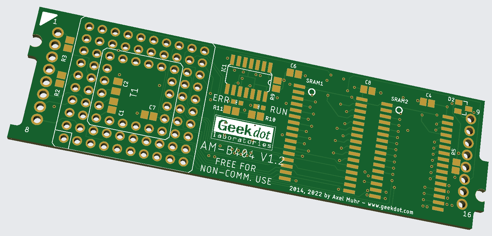
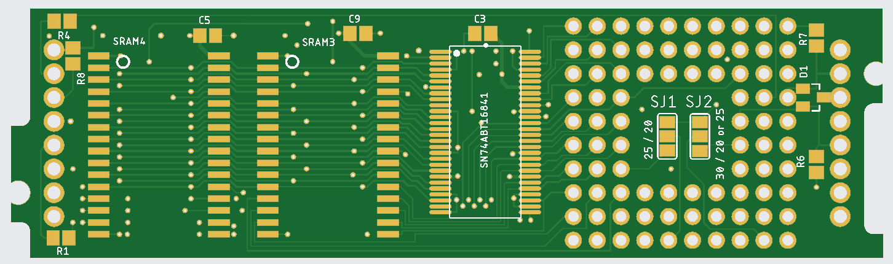

# AM-B404 – a Size-1 Transputer TRAM with 2 MB SRAM

The **AM-B404** is a DIY Transputer TRAM (TRAnsputer Module), named in reminiscence of the INMOS IMS-B404, which comes closest to its specs. It was designed to give Transputer enthusiasts an affordable way to build their own CPU TRAMs instead of paying crazy prices for original modules.

More background, photos and a video of the AM-B404 running Helios on an INMOS B020 can be found on my blog:
👉 https://www.geekdot.com/the-am-b404/

## Features

- **Size-1 TRAM**, low profile
- **2 MB of low-power SRAM** (4 × 512K×8) – the *whole* memory is accessed with 3 cycles (the original IMS-B404 used 4-cycle DRAM)
- Works with **T800 and T425** Transputers (84-pin PGA, socketed)
- CPU clock selectable via solder jumpers: **20, 25 or 30 MHz**
- **2 status LEDs**: RUN (green) and ERROR (red) – because we all know how important LEDs are 😉
- 6-layer PCB with modern SMD parts (as modern as 5V parts can get)
- Approx. **100 mA** power consumption for the board (without the Transputer)

## Repository contents

This repository contains the **Gerber files** of the AM-B404, ready to be sent to a PCB manufacturer, plus this BOM.

## Things to know before you build one

### The PCB is 6 layers

6-layer boards aren't exactly cheap. At the time of writing, JLCPCB charges about **28 €** for their minimum order of 5 boards – **plus shipping and customs**.

### SRAM speed matters

The SRAMs are 5V **512K×8** parts in a wide SOP32 package. They aren't cheap either, and you need four of them. Speed requirements depend on the CPU clock:

| CPU clock        | Required SRAM access time |
|------------------|---------------------------|
| 20 MHz / 25 MHz  | **55 ns** or faster       |
| 30 MHz           | **45 ns** or faster       |

### Clock selection (solder jumpers on the back)

There are two solder jumpers on the bottom side of the PCB:

- **Jumper SJ1 – "25 / 20"**: selects 25 or 20 MHz
- **Jumper SJ2 – "30 / 20 or 25"**: selects between 30 MHz and the 20/25 MHz range

| CPU clock | Jumper 1 | Jumper 2   |
|-----------|----------|------------|
| 20 MHz    | 20       | 20 or 25   |
| 25 MHz    | 25       | 20 or 25   |
| 30 MHz    | **25**   | **30**     |

Make sure your Transputer (and your SRAM, see above) is actually rated for the clock you select!

### TRAM pins

The TRAM pins have been changed to **standard 1.4 mm pins**, which are easy and cheap to source (the original TRAM pins are very special parts that you have to buy by the thousands).

## Bill of Materials

### Top side

| Part          | Value        | Package  | Notes                       |
|---------------|--------------|----------|-----------------------------|
| R2, R3        | 56 Ω         | 0805     |                             |
| R5, R9        | 10 kΩ        | 0805     |                             |
| R10, R11      | 150 Ω        | 0805     | LED resistors – adjust to your LED specs |
| C1            | 1.0 µF       | 0805     |                             |
| C2            | 4.7 µF       | 0805     |                             |
| C4, C6, C7, C8| 100 nF       | 0805     |                             |
| D2            | BAV70        | SOT-23   |                             |
| ERR           | LED, red     | 0603     | Error LED                   |
| RUN           | LED, green   | 0603     | Run LED                     |
| IC1           | 74HCT03D     | SO-14    |                             |
| SRAM1, SRAM2  | 512K×8 SRAM  | SOP32 (wide) | 5V, see speed table above |

### Bottom side

| Part          | Value        | Package  | Notes                       |
|---------------|--------------|----------|-----------------------------|
| R1, R4        | 56 Ω         | 0805     |                             |
| R6, R7, R8    | 10 kΩ        | 0805     |                             |
| C3, C5, C9    | 100 nF       | 0805     |                             |
| D1            | BAV70        | SOT-23   |                             |
| U (latch)     | SN74ABT16841 | SSOP-56  |                             |
| SRAM3, SRAM4  | 512K×8 SRAM  | SOP32 (wide) | 5V, see speed table above |

### Through-hole parts

| Part          | Qty | Notes                                   |
|---------------|-----|-----------------------------------------|
| TRAM pins     | 16  | Standard 1.4 mm pins                    |
| PGA socket    | 1   | 84-pin PGA socket for the Transputer    |
| Transputer    | 1   | T800 or T425 (not included, obviously…) |

> **Tip – the PGA socket:** 84-pin PGA sockets for Transputers are almost impossible to find these days. You can build a replacement from ordinary **2.54 mm (0.1") female pin headers** (turned/precision pin strips work best): cut them to length and solder them in rows following the PGA footprint. Put the Transputer into the headers *before* soldering, so everything lines up nicely.
>
> ⚠️ If you do solder with the Transputer inserted, **don't dwell on a single pin for too long** – the heat travels straight into the CPU, and vintage Transputers don't appreciate that. Solder quickly, and let things cool down between pins or jump around the socket instead of working row by row.

### Summary

| Component        | Total qty |
|------------------|-----------|
| 56 Ω (0805)      | 4         |
| 10 kΩ (0805)     | 5         |
| 150 Ω (0805)     | 2         |
| 100 nF (0805)    | 7         |
| 1.0 µF (0805)    | 1         |
| 4.7 µF (0805)    | 1         |
| BAV70 (SOT-23)   | 2         |
| LED 0603         | 2         |
| 74HCT03D         | 1         |
| SN74ABT16841     | 1         |
| 512K×8 SRAM      | 4         |

## License

This design is released under the **Creative Commons Attribution-NonCommercial-ShareAlike 4.0 International** license (CC BY-NC-SA 4.0).

You are free to build, modify and share the design for **non-commercial** purposes, as long as you give appropriate credit and share your modifications under the same license. **Commercial use – including selling boards or kits made from this design – is not permitted.**

Full license text: https://creativecommons.org/licenses/by-nc-sa/4.0/

---

© Axel Muhr – [geekdot.com](https://www.geekdot.com)
